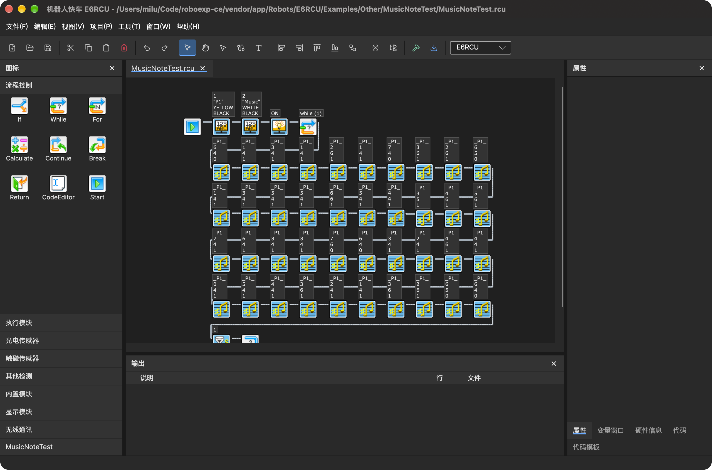

# RoboEXP-CE

**原生跨平台的 RoboEXP 社区版，让竞赛编程更加便捷**

打开原版 `.rcu` 工程，用流程图编写程序、查看 C 代码，编译后下载到机器人控制器。

[下载安装](https://github.com/Mxmilu666/RoboEXP-CE/releases) · [问题反馈](https://github.com/Mxmilu666/RoboEXP-CE/issues)

## 界面预览

*实际运行截图，打开 E6RCU 音乐例程。*

## 你可以做什么

- **画流程图**：拖放模块、连接线路、编辑参数，支持对齐、撤销和重做。
- **继续使用原版工程**：读取和保存 `.rcu` 文件，保留模块图标与布局；支持原版模块复制格式。
- **查看与编辑代码**：流程图生成 C 代码，提供语法高亮和编译错误定位。
- **管理工程**：配置变量、子程序和硬件端口，查看参数说明与示例。
- **下载到机器人**：支持 USB HID、控制器磁盘、蓝牙串口和 Wi-Fi，具体方式取决于控制器型号。
- **按习惯调整界面**：浅色、深色或自动跟随系统；支持简体中文、繁体中文和英文。

## 下载与安装

前往 [Releases](https://github.com/Mxmilu666/RoboEXP-CE/releases)，选择与你的系统和处理器匹配的文件；实际提供的平台以发布页面为准。

| 平台 | 安装方式 |
| --- | --- |
| Windows | 运行安装程序，或解压 ZIP 后打开 `RoboExp.App.exe`；ARM64 版需要 Windows 11 ARM64 |
| macOS | 打开 DMG，将 `RoboExp.app` 拖入「应用程序」 |
| Linux | 解压后运行 `RoboExp.App` |

无需另装 .NET。**自动发布的完整离线包已内置机器人资源和对应平台的编译器，不需要再导入原版或下载工具链。** 免安装版请保留整个解压目录。

## 快速开始

1. **选择控制器型号**，打开已有 `.rcu` 工程或内置例程。
2. **编辑程序**：从左侧拖入模块，连线后右键编辑参数；在属性帮助区查看参数说明。
3. **编译并下载**：连接控制器、进入下载模式，再执行编译和下载。蓝牙需先在系统中配对，Wi-Fi 使用控制器的配对码。

主题在「**工具 → 选项 → 全局 → 主题**」中切换，点确定后立即生效并保存。

## 支持的控制器

MRCU · M2RCU · M6RCU · E2RCU · E3RCU · E6RCU · E7RCU · C1RCU · C6RCU · X3RCU · X4RCU · IQ2Robot

暂不支持 X1RCU、QRCU、RCJ 系列、EV5、IQrobot 和 X2RCU。

## 使用前注意

- 跨型号打开工程后，请重新核对硬件端口和参数。复制模块不会自动携带外部子程序文件或硬件定义。
- 新编译器生成的固件可能比原版更大，请留意控制器的容量限制。
- macOS 下载可能需要允许「可移动宗卷」或「本地网络」访问；Linux 的 USB HID 和串口需要相应设备权限。
- 已在 macOS 验证主要界面与编辑流程。Windows ARM 真机、与原版程序的剪贴板双向交互，以及全部控制器下载组合尚未完成实测。

## 版权与致谢

@Mxmilu 2026 · [github.com/Mxmilu666/RoboEXP-CE](https://github.com/Mxmilu666/RoboEXP-CE)

自编写部分采用 [MIT License](https://opensource.org/license/mit)。原版 RoboEXP 资源及第三方内容遵循各自授权，不属于 CE 代码许可范围；本项目与原版厂商无隶属或官方支持关系。

图标使用 Lucide / Feather 衍生资源。开屏插画：[Pixiv PID: 132125952](https://www.pixiv.net/artworks/132125952)，未确认转载授权。详情见 [THIRD-PARTY-NOTICES](THIRD-PARTY-NOTICES)。
